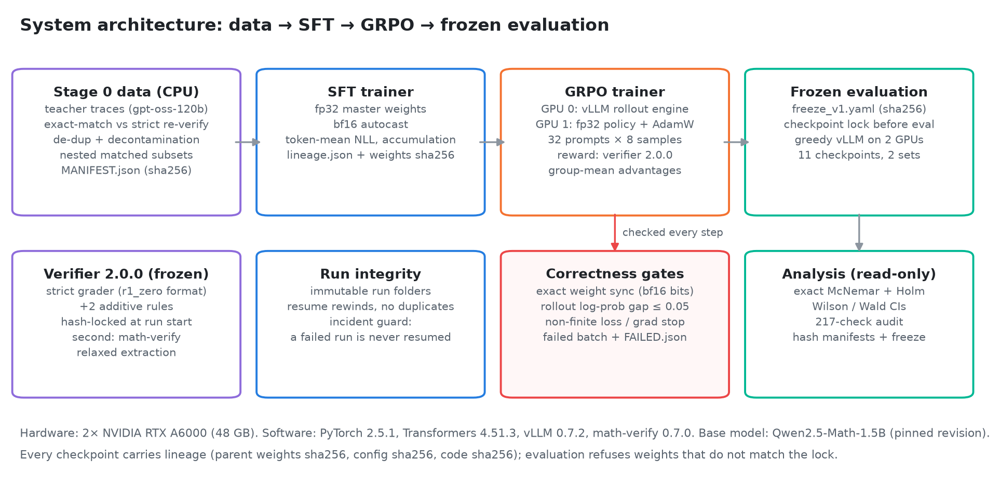
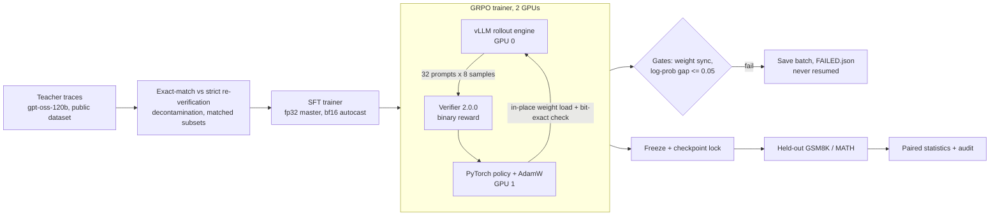
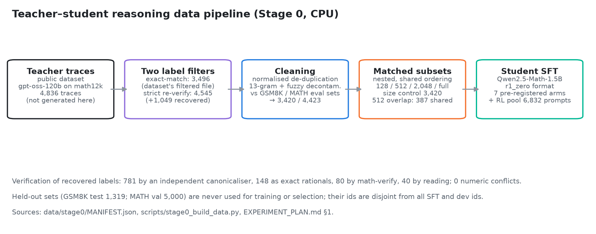
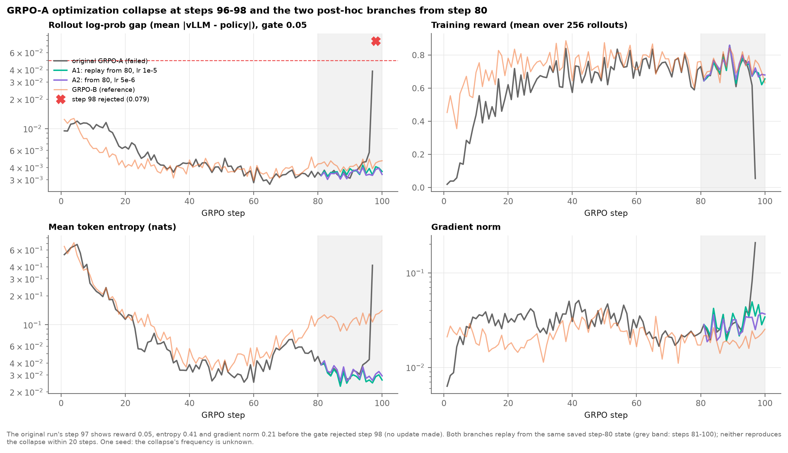
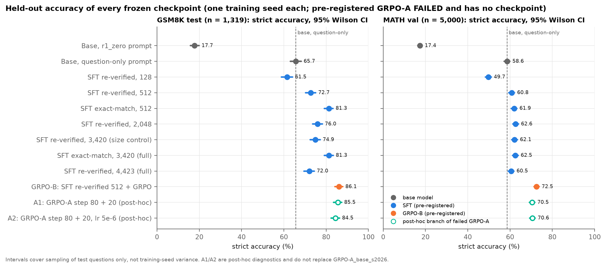
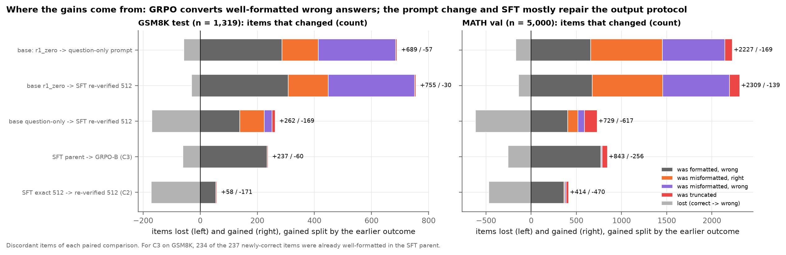
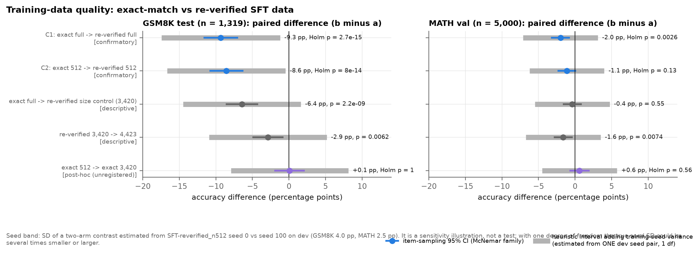
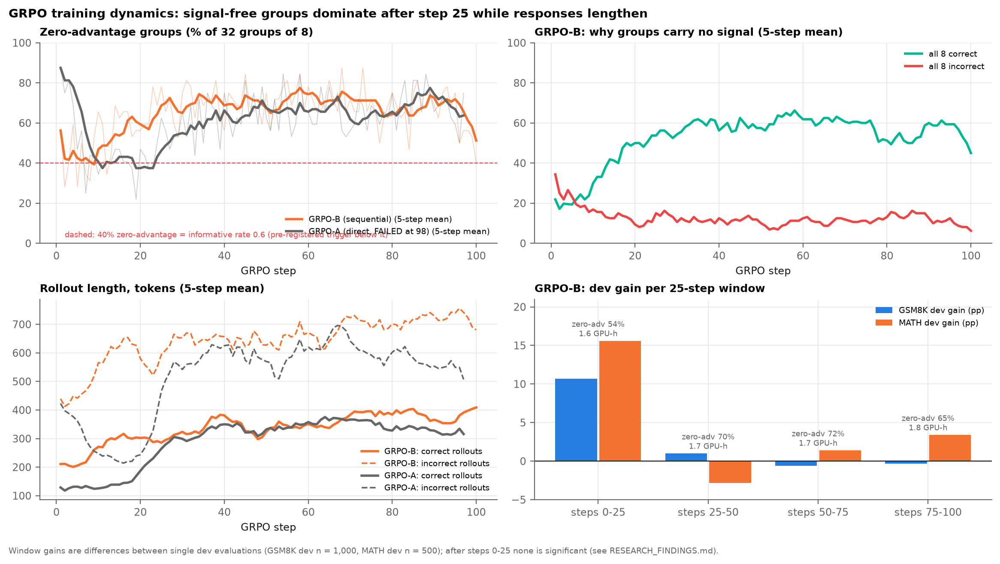
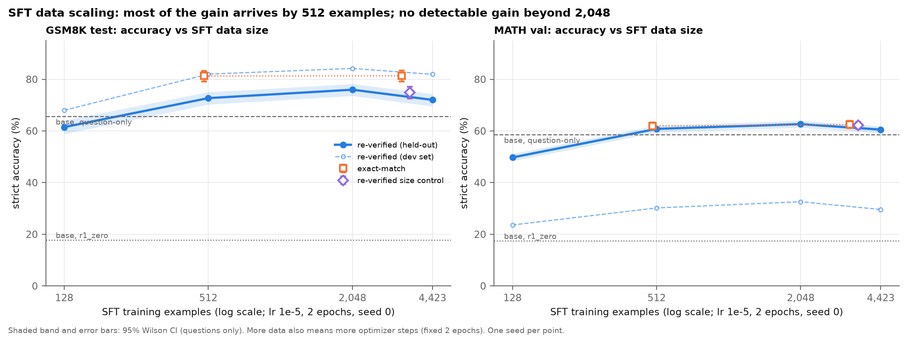

# LLM-PostTraining-Lab

**LLM Reasoning Post-Training with SFT and GRPO**

The experimental framework investigates mathematical reasoning through supervised fine-tuning and reinforcement learning with verifiable rewards. Existing mathematical verification components and prompt templates are incorporated with their original attribution and licensing, as documented in [THIRD_PARTY_NOTICES.md](THIRD_PARTY_NOTICES.md).

*LLM engineering and empirical research.* Focus areas:
- reasoning data engineering;
- LLM supervised fine-tuning;
- online reinforcement learning;
- multi-GPU training and inference infrastructure;
- numerical stability and checkpoint recovery;
- statistical benchmark evaluation.

The project built a post-training system for **Qwen2.5-Math-1.5B** and used it in a pre-registered empirical study:
- **SFT:** supervised fine-tuning on curated, re-verified teacher reasoning traces;
- **GRPO:** online reinforcement learning with verifiable rewards, on a dual-GPU PyTorch + vLLM stack;
- **Evaluation:** every model was evaluated once on held-out **GSM8K** (1,319) and **MATH** (5,000), under a hash-locked protocol.

📄 [Technical report](report/TECHNICAL_REPORT.md) ([PDF](report/TECHNICAL_REPORT.pdf)) · [Executive summary](report/EXECUTIVE_SUMMARY.md) · [Reproducibility](report/REPRODUCIBILITY.md) · [Package and code identity](docs/PACKAGE_MIGRATION.md) · [About this repository](docs/PUBLIC_EXPORT.md)

## Results at a glance

- **GRPO over its SFT parent:** **+13.4 pp GSM8K / +11.7 pp MATH**.
  - Held-out and pre-registered (Holm p = 1.9e-25 / 5.7e-73).
  - The final model reached **86.1% on GSM8K and 72.5% on MATH**, against 65.7% / 58.6% for the base model's best prompt.
- **The gain is reasoning, not formatting.**
  - 234 of the 237 GSM8K items that GRPO newly solved were already well formatted but wrong.
  - The gain holds under relaxed and second-verifier scoring.
- **1,049 recovered reasoning traces.** Strict mathematical re-verification recovered 1,049 traces that a string-match filter had rejected.
- **17 training runs and 11 evaluated model groups**, under a frozen evaluation plan and checkpoint lock.

**Held-out accuracy (strict scoring, greedy decoding)**

| Model | GSM8K | MATH |
|---|---|---|
| Base, R1-Zero prompt | 17.7% | 17.4% |
| Base, question-only prompt | 65.7% | 58.6% |
| SFT parent (512 re-verified examples) | 72.7% | 60.8% |
| SFT, exact-match data (3,420 examples) | 81.3% | 62.5% |
| **SFT → GRPO (100 steps)** | **86.1%** | **72.5%** |

## Architecture





## Engineering contributions

### 1. Reasoning data curation and re-verification



- **Teacher traces:** 4,836 math12k reasoning traces from the public `garg-aayush/sft-cs336-assign5-datasets`. The dataset's file names identify the teacher as gpt-oss-120b. The traces were curated and re-verified here, not generated.
- **Exact-match filter:** the dataset's own string-match filtered file (3,496 traces).
- **Strict re-verification:** LaTeX normalisation plus numeric and symbolic equivalence (4,545 traces).
  - This recovered 1,049 rejected traces.
  - The recoveries were confirmed independently, with 0 numeric conflicts.
- **Decontamination and controls:**
  - n-gram and fuzzy matching against the GSM8K and MATH evaluation sets, then de-duplication, leaving 3,420 exact-match and 4,423 re-verified examples;
  - nested matched subsets (128 / 512 / 2,048 / full), plus a size control that separates data composition from data volume.

### 2. Supervised fine-tuning

- **Objective:** response-masked NLL, averaged over all response tokens in a 32-sequence batch.
- **Accumulation:** exact gradient accumulation; micro-batching never changes the gradient (unit-tested).
- **Optimizer:** AdamW, lr 1e-5, 2 epochs. The learning rate was chosen on dev sets by a rule fixed in advance.

### 3. Online RL with verifiable rewards

| Stage | What runs |
|---|---|
| **Rollout** | vLLM samples 8 responses for each of 32 prompts (temperature 1.0, ≤ 1,024 tokens) from the current weights |
| **Reward / advantage** | Binary verifier reward; advantage = reward − group mean (no std normalisation) |
| **Update** | Clipped surrogate with a constant length normaliser. There is one optimizer step per rollout batch, so the ratio is 1 and clipping is inactive: the update is REINFORCE with a group baseline. No KL term |
| **Pathways** | Sequential (base → SFT → GRPO) and direct (base → GRPO), both pre-registered |

### 4. Dual-GPU training and inference architecture

- **Device split:** the vLLM rollout engine runs on GPU 0; the fp32 policy and AdamW run on GPU 1.
- **Weight sync:** weights are loaded into vLLM in place each step.
- **Mixed precision:** fp32 master weights with bf16 autocast. Pure bf16 left 91.3% of weights unchanged per step at lr 1e-5.
- **Memory:** token-budget micro-batching bounds peak memory without changing the gradient.
- **Checkpoints:** atomic, with lineage hashes (parent, config, code). Resume restores model, optimizer and RNG state and never duplicates logged steps.

### 5. Numerical stability and checkpoint recovery



**Gates**
- **Bit-exact weight check:** before each rollout, every engine tensor must equal the bf16-converted policy tensor.
- **Token-level log-prob gate:** before each update, the mean |vLLM − PyTorch| log-prob over all rollout tokens must be ≤ 0.05. If it is not, the batch is saved and the run is stopped.

**The failed GRPO-A run**
- The pre-registered **direct** run trained normally for 95 steps and reached 92.9% GSM8K dev at step 75.
- At update 96 it collapsed: training reward fell from 0.62 to 0.055, while the answer format was kept.
- At step 98 the gate rejected the next batch (gap 0.079 > 0.05) before any update.
- **GRPO-A is recorded as FAILED.** Its pre-registered comparison is unavailable.

**Diagnosis**
- **Ruled out:** the verifier (0 errors; every saved reward reproduces) and stale weights (the bit-exact check passed every step).
- **Supported:** optimization instability from a low-entropy plateau.

**Recovery protocol**
- The failed run was preserved, never resumed.
- Two diagnostic branches restarted from its verified step-80 state: a same-learning-rate replay, which reproduced step 81 exactly, and a halved learning rate. Neither collapsed.
- They are post-hoc diagnostics and do **not** complete the registered run.

### 6. Statistical benchmark evaluation



| Question | Result (GSM8K / MATH) | Evidence |
|---|---|---|
| GRPO over its SFT parent | **+13.4 / +11.7 pp** | Confirmatory |
| Exact-match vs verifier-recovered SFT data | Recovered data **−9.3 / −2.0 pp** (full), **−8.6 / −1.1 pp** (512; MATH n.s.) | Confirmatory, single seed |
| SFT (≥ 512 examples) vs base question-only | +6 to +16 / +2 to +4 pp; 128 examples: −4.2 / −8.8 pp | Confirmatory-secondary |
| Prompt effect on the base model | +47.9 / +41.2 pp | Descriptive |
| Direct GRPO from base | **Failed at step 98**; comparison unavailable | Negative result |
| GRPO returns over 100 steps (dev) | Measurable gain only in steps 0–25; ~two-thirds zero-advantage groups after | Exploratory |

**Methods**
- Exact McNemar tests with Holm families.
- Strict, second-verifier and relaxed scoring.
- An item-level formatting-vs-reasoning decomposition of each gain.

| | |
|---|---|
|  |  |
| Item-level sources of each gain | Exact-match vs re-verified data |
|  |  |
| GRPO dynamics: zero-advantage groups, lengths | SFT data scaling |

### 7. Reproducible experimentation

- **Run registry:** every run is defined in `EXPERIMENT_REGISTRY.csv`. Configs are generated from it, and gated launchers refuse to run without explicit authorisation.
- **Pre-registration:** the learning-rate rule and confirmatory comparisons were fixed in advance. The held-out plan (`final/freeze_v1.yaml`) was frozen and hashed before any held-out result existed.
- **Checkpoint lock:** weight hashes of all 11 evaluated model groups, written before the first evaluation.
- **Hash-locked verifier:** a hash-locked verifier with golden cases. Every run records its config, code and verifier hashes (`results/run_records/`).
- **Audits:** a 217-check artifact audit, and an independent recomputation of every statistic with 0 mismatches.
- **Tests:** 174 passing CPU tests in the full project environment. A clean clone passes 168 and skips 6 that need the rebuilt datasets.
- **Code identity:** [`scripts/verify_code_lineage.py`](scripts/verify_code_lineage.py) shows that this release, with its package reorganisation reversed, is the code version recorded in the checkpoint lock ([details](docs/PACKAGE_MIGRATION.md)).

## Installation and reproduction

```bash
git clone <this repository> && cd LLM-PostTraining-Lab
uv venv --python 3.12 .venv && . .venv/bin/activate
uv pip install -r requirements-cloud.lock.txt         # exact versions of every run: torch 2.5.1, transformers 4.51.3, vllm 0.7.2 (Linux, CUDA 12.4)
python -m pytest tests -q                             # CPU tests: 168 passed, 6 skipped without the rebuilt datasets
python scripts/verify_code_lineage.py                 # release code -> the code identity recorded by the runs

# regenerate the report tables and re-check every key claim from the shipped run records (CPU)
R="--runs results/run_records/a5_sessions --runs results/run_records/a5_recovery"
python report/scripts/make_tables.py $R
python report/scripts/key_claims.py $R --final results/run_records/a5_final
```

**What this repository ships**
- Code, configs and tests.
- The frozen evaluation plan.
- Aggregate held-out results and their statistical analysis.
- Run records for all 17 training runs.
- Id lists for every training subset.

**What it does not ship**
- Model weights.
- Item-level model outputs.
- The dataset text, which can be rebuilt from public sources with `scripts/stage0_build_data.py`.

**GPU runs** (2 GPUs)
- **Launchers:**
  - `scripts/server_tier_a.sh`: SFT and GRPO sessions;
  - `scripts/server_recovery.sh`: diagnostic branches;
  - `scripts/server_final_eval.sh`: locked held-out evaluation.
- **Compute:** about 34 GPU-h of training and tuning, plus about 3 GPU-h of evaluation, on RTX A6000s.

## Repository structure

```
posttrain/             the post-training system: SFT and GRPO trainers, vLLM engine + sync gates, losses,
                       micro-batching, reward wrapper, evaluation, checkpoint lineage, run integrity, fork/recovery, statistics
posttrain/verifiers/   strict math grader (third-party, Apache-2.0)
posttrain/prompts/     prompt templates
configs/               generated configs for every registered run
scripts/               data build and verification, gated launchers, diagnostics, recovery, analysis, audit, code lineage
tests/                 CPU tests (pytest)
data/stage0/           dataset manifest (hashes, counts), contamination report, subset id lists, recovery decisions
final/                 frozen held-out evaluation plan (freeze_v1.yaml)
recovery/              incident record and diagnostic-branch specifications
results/               held-out report, frozen research analysis, incident analysis, run records
report/                technical report (Markdown + PDF), figures, tables, audits and build scripts
docs/                  package migration and code lineage, notes on this repository
```

## Limitations

- **Single seed:**
  - Each arm was trained once, so intervals reflect question sampling, not training-seed variance.
  - The data-quality result is about 2 standard errors from zero once a seed-variance estimate is added.
- **Failed comparison:** the pre-registered direct-vs-sequential GRPO comparison is unavailable because GRPO-A failed. The two diagnostic branches do not replace it.
- **Verifier:** one verifier serves as both reward and metric.
- **Contamination:** pretraining exposure to GSM8K and MATH cannot be ruled out.
- **Scope:** one model size, one teacher, greedy decoding at 1,024 tokens.
- **Not claimed:**
  - a novel algorithm;
  - a measured speedup;
  - multi-seed robustness;
  - production use.

## Future work

- Seed replication of the SFT arms and of GRPO.
- Clean direct-GRPO runs, with failures counted.
- A measured test of zero-advantage filtering, whose pre-registered trigger was met.
- A pre-registered early-stopping test near step 25.

## Provenance and licences

**Third-party components and inputs (not this project's work)**
- **Strict grader:** `posttrain/verifiers/drgrpo_grader.py`, the Dr. GRPO grader (Apache-2.0), unchanged.
- **R1-Zero prompt template:** the DeepSeek-R1-Zero format, with text from the MIT-licensed Dr. GRPO code.
- **SFT traces:** a public dataset of gpt-oss-120b traces.
- **Base model:** Qwen2.5-Math-1.5B (Apache-2.0).

**Shared starting point:** the experimental setting follows public materials, including the Stanford CS336 alignment materials. This project is not affiliated with Stanford.

**This project's work:** the post-training system, data re-verification, experiments, analysis and report. They were developed with substantial AI coding assistance (Claude Code) under the author's direction. The author specified the study, made the experimental decisions, ran every training and evaluation job, and is responsible for the interpretation.

Details: [`THIRD_PARTY_NOTICES.md`](THIRD_PARTY_NOTICES.md). Licence for this project's own files: [`LICENSE`](LICENSE).
