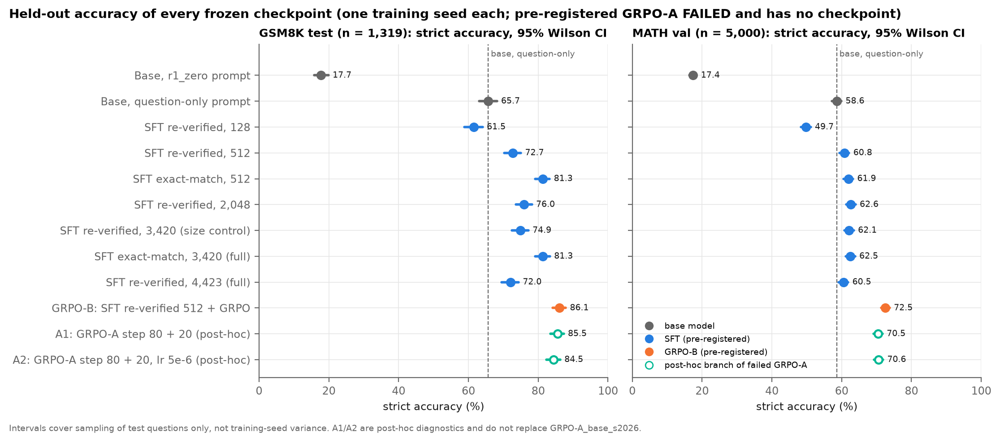
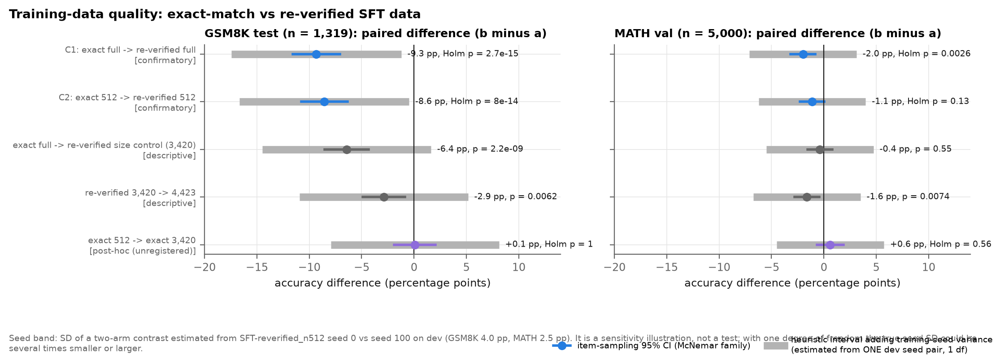
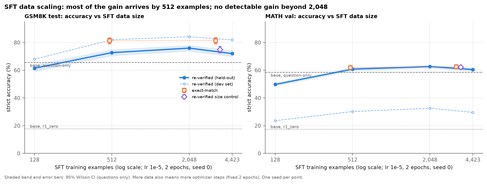
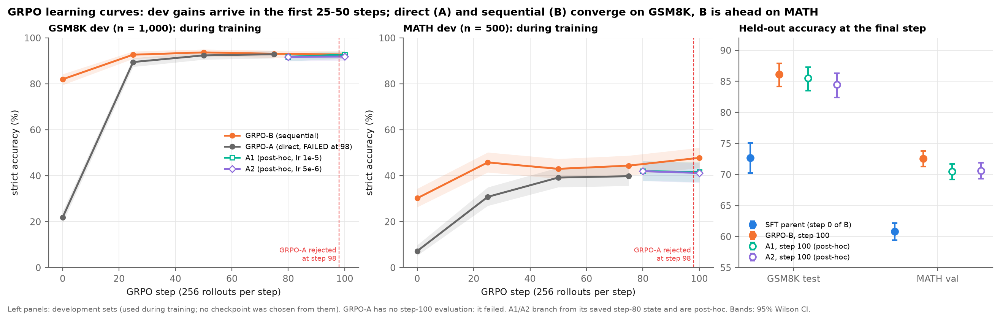
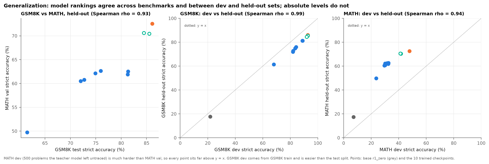
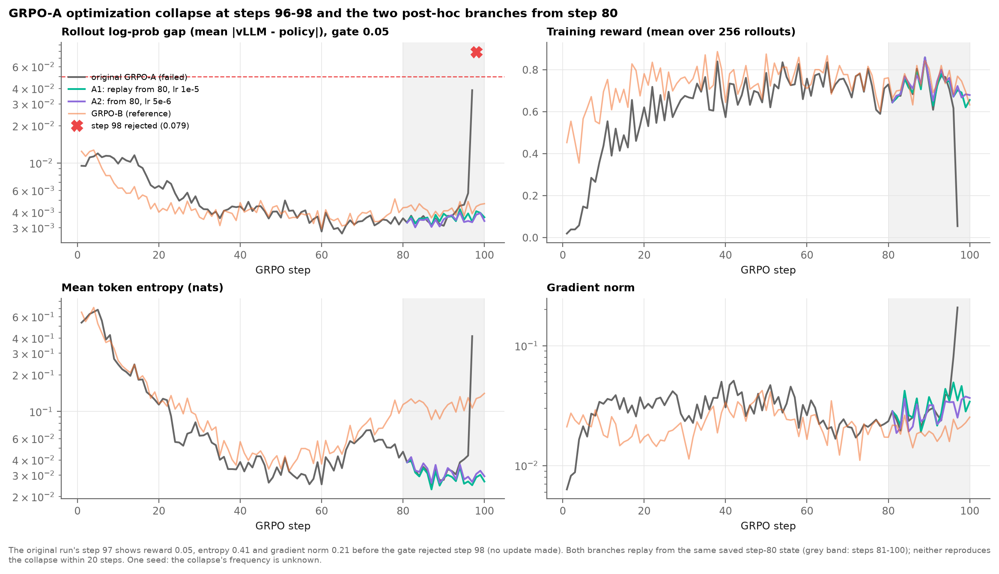
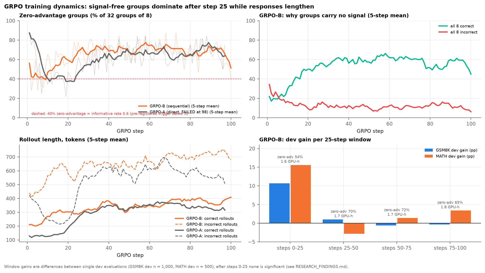
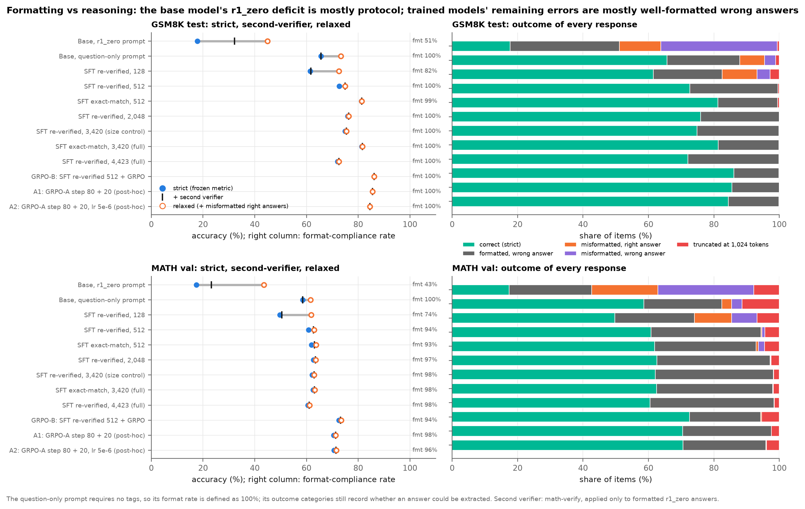
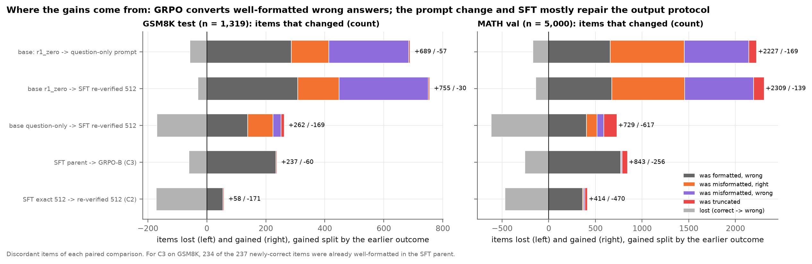
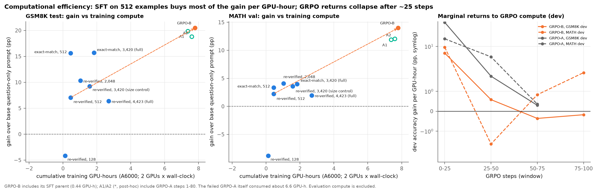

# Research findings: SFT and GRPO post-training of Qwen2.5-Math-1.5B

Held-out sets: GSM8K test (n = 1,319, primary) and MATH val (n = 5,000, secondary). Each checkpoint was evaluated once, under the frozen plan `final/freeze_v1.yaml`.
The primary metric is strict accuracy under verifier 2.0.0.

Statistics follow the frozen plan:
- paired difference (b − a) with a 95% Wald CI;
- exact McNemar test;
- Holm correction within each family and set;
- on GSM8K, differences smaller than 1.4 pp are reported as "not detected".

Tables: `statistical_comparisons.csv`, `consolidated_results.csv`. Figures: `figures/`. Audit: `AUDIT.md`.

**Evidence labels**

| Label | Meaning |
|---|---|
| **Confirmatory** | Pre-registered C1–C4; Holm m = 4 per set |
| **Confirmatory-secondary** | Pre-registered SFT vs base question-only; m = 7 |
| **Descriptive** | Pre-registered; CI and unadjusted p only |
| **Post-hoc (frozen)** | A1/A2 family; m = 4 |
| **Post-hoc (unregistered)** | Chosen after seeing held-out results; m = 5 |
| **Exploratory (dev)** | Development-set training curves |

**Two kinds of uncertainty**
- Every CI and p-value below covers **sampling of evaluation questions only**.
- Each arm was trained **once** (one seed). The only same-data, same-learning-rate seed contrast in the project is on dev: SFT-reverified_n512, seed 0 vs seed 100. It moved GSM8K dev by **4.1 pp** (p = 1e-4).
- Treating that pair as an estimate (1 degree of freedom), the training-seed SD of a two-arm SFT contrast is about **4.0 pp on GSM8K and 2.5 pp on MATH**.
- `data/seed_sensitivity.csv` shows each contrast with that variance added. This is a heuristic sensitivity analysis, not a test.

**The pre-registered direct-GRPO run (GRPO-A_base_s2026) FAILED at step 98.** Comparison C4 is unavailable. A1 and A2 are post-hoc branches from its step-80 state; they never stand in for it.

## Results at a glance

| Checkpoint | GSM8K strict (95% CI) | MATH strict (95% CI) | Format (GSM8K / MATH) | Cumulative GPU-h |
|---|---|---|---|---|
| Base, r1_zero prompt | 17.7 (15.8–19.9) | 17.4 (16.4–18.5) | 51.1 / 42.6 | 0 |
| Base, question-only prompt | 65.7 (63.1–68.2) | 58.6 (57.2–59.9) | 100 (n/a) | 0 |
| SFT re-verified 128 | 61.5 (58.8–64.1) | 49.7 (48.4–51.1) | 82.5 / 74.0 | 0.12 |
| SFT re-verified 512 | 72.7 (70.2–75.0) | 60.8 (59.4–62.1) | 99.6 / 94.4 | 0.44 |
| SFT exact-match 512 | 81.3 (79.1–83.3) | 61.9 (60.6–63.3) | 99.5 / 92.9 | 0.44 |
| SFT re-verified 2,048 | 76.0 (73.6–78.2) | 62.6 (61.3–64.0) | 100 / 97.2 | 1.03 |
| SFT re-verified 3,420 (size control) | 74.9 (72.5–77.2) | 62.1 (60.8–63.5) | 99.8 / 98.2 | 1.57 |
| SFT exact-match 3,420 (full) | 81.3 (79.2–83.4) | 62.5 (61.2–63.9) | 99.8 / 98.0 | 1.83 |
| SFT re-verified 4,423 (full) | 72.0 (69.5–74.4) | 60.5 (59.2–61.9) | 99.9 / 98.4 | 2.69 |
| **GRPO-B** (SFT re-verified 512 + GRPO) | **86.1 (84.2–87.9)** | **72.5 (71.3–73.8)** | 99.9 / 94.3 | 7.79 |
| GRPO-A (direct) | FAILED, no checkpoint | FAILED | – | 6.61 spent |
| A1, post-hoc (A step 80 + 20, lr 1e-5) | 85.5 (83.5–87.3) | 70.5 (69.2–71.7) | 100 / 97.6 | 7.36 |
| A2, post-hoc (A step 80 + 20, lr 5e-6) | 84.5 (82.4–86.3) | 70.6 (69.3–71.9) | 99.9 / 95.9 | 7.59 |

## RQ1. Effectiveness of supervised fine-tuning (confirmatory-secondary)

The frozen plan judges SFT against the base model's **question-only** prompt, the reasoning baseline. Comparing against r1_zero mostly measures whether the output protocol was learned.

| SFT arm vs base question-only | GSM8K diff [95% CI], Holm p | MATH diff [95% CI], Holm p | GSM8K relaxed diff |
|---|---|---|---|
| exact full (3,420) | +15.7 [+12.9, +18.5], 1e-25 | +4.0 [+2.6, +5.4], 1.5e-7 | +8.3 |
| exact 512 | +15.6 [+12.8, +18.4], 7e-26 | +3.4 [+2.0, +4.8], 1e-5 | +8.1 |
| re-verified 2,048 | +10.3 [+7.3, +13.3], 2e-10 | +4.1 [+2.7, +5.5], 6e-8 | +3.0 |
| size control (3,420) | +9.2 [+6.3, +12.2], 5e-9 | +3.6 [+2.2, +5.0], 3e-6 | +2.2 |
| re-verified 512 | +7.1 [+4.0, +10.1], 3e-5 | +2.2 [+0.8, +3.7], 0.005 | +1.7 |
| re-verified full (4,423) | +6.4 [+3.3, +9.4], 1e-4 | +2.0 [+0.5, +3.4], 0.008 | −0.7 |
| re-verified 128 | **−4.2** [−7.4, −0.9], 0.014 | **−8.8** [−10.3, −7.3], 1e-29 | −0.8 |

**Supported:** six of seven SFT arms beat the base model's best prompt on both benchmarks (Holm p < 0.01 in every case).

**Not supported for n = 128:** a significant difference was detected in the opposite direction. The generated report labels it "supported", which here means only "difference detected"; see `AUDIT.md` section 2.

**Gains are concentrated in the output protocol**
- Against the base model's own r1_zero prompt, SFT on 512 examples adds about +55 pp on GSM8K. Most of that is protocol.
- Against question-only on GSM8K, the strict advantage is 6–16 pp. Under relaxed scoring it shrinks to −0.8 to +8.3 pp. The base question-only output often contains the right answer in a form the strict extractor cannot read: 7.5 pp of GSM8K items.
- So for the re-verified arms, most of the GSM8K strict gain over question-only comes from answers that become extractable, not from items newly solved.
- On MATH, the gains are small: +2 to +4 pp.

## RQ2. Exact-match vs re-verified training data (confirmatory C1, C2)

| Contrast | GSM8K | MATH | Label |
|---|---|---|---|
| C1 full: exact 3,420 → re-verified 4,423 | **−9.3** [−11.6, −7.1], Holm 2.7e-15 | **−2.0** [−3.2, −0.8], Holm 0.003 | confirmatory: difference detected, re-verified worse |
| C2 matched 512 | **−8.6** [−10.8, −6.4], Holm 8e-14 | −1.1 [−2.3, +0.0], Holm 0.13 | confirmatory: GSM8K detected; MATH not detected |
| exact 3,420 → re-verified 3,420 (size control) | −6.4 [−8.5, −4.4], p 2e-9 | −0.4 [−1.6, +0.8], p 0.55 | descriptive |
| re-verified 3,420 → 4,423 (volume) | −2.9 [−4.9, −0.9], p 0.006 | −1.6 [−2.8, −0.4], p 0.007 | descriptive |

**Finding.** On GSM8K, every arm trained with recovered traces scored 6–9 pp below the matching exact-match arm.
- The data overlap is large:
  - The re-verified full set contains all 3,420 exact-match examples plus 1,003 recovered ones.
  - The size control shares 2,601 of its 3,420 examples with the exact set.
  - At n = 512, the two subsets share 387 of 512 examples.
- On MATH the effect is small: −2.0 pp in C1, not detected in C2.
- The direction is **opposite** to the motivation for recovering the traces. The tests were two-sided, so the confirmatory finding is "a difference exists, favouring exact-match data".

**How robust it is**
- **To question sampling:** very (p ≤ 1e-13 on GSM8K).
- **To training seed: only moderately.** With the dev-estimated seed SD added, C1 and C2 sit about 2.1–2.3 combined SEs from zero.
- The dev seed pair shows why caution is needed. The re-verified 512 run with a different seed scored 86.1% on GSM8K dev, against 88.9% for exact 512. On dev, the 6.9 pp C2 gap shrinks to 2.8 pp under a seed change.
- The MATH differences lie well inside the seed band.

**Mechanism.** The following is consistent with the evidence but not established.
- **About a quarter of the C2 gap is verifier-style.** Under the math-verify second verifier the gap is −6.4 pp, not −8.6.
- **The rest is real wrong answers.** Of the 171 items lost from exact 512 to re-verified 512, 169 were well-formatted but wrong.
- **Possible cause: answer style.** The recovered traces are those whose final answer did not string-match the reference (units, alternative forms). Training on them may teach answer styles that the strict verifier rejects, and possibly looser answer habits.
- **Possible cause: problem mix.** The exact-match filter also skews toward simply-formatted problems, so the two pools differ in problem mix as well as label quality.
- **Untested.** Nothing here separates these explanations.

## RQ3. SFT data scaling and diminishing returns (descriptive)

| Step | GSM8K | MATH |
|---|---|---|
| 128 → 512 | +11.2 [+8.2, +14.2], p 6e-13 | +11.1 [+9.6, +12.5], p 4e-50 |
| 512 → 2,048 | +3.3 [+1.0, +5.5], p 0.005 | +1.8 [+0.6, +3.1], p 0.005 |
| 2,048 → 4,423 | −3.9 [−6.0, −1.9], p 2e-4 | −2.1 [−3.3, −0.9], p 5e-4 |
| exact 512 → 3,420 (post-hoc) | +0.1 [−1.9, +2.1], Holm 1.0 | +0.6 [−0.7, +1.9], Holm 0.56 |

**The return to SFT data falls sharply after 512 examples.**
- The jump from 128 is large, and a good part of it is format. At n = 128 the GSM8K format rate is 82.5%, and relaxed accuracy is 72.5% against 61.5% strict.
- Beyond 512, single-seed differences of 2–4 pp go both ways. They are within the training-seed band, so the curve is flat-to-noisy, not demonstrably rising or falling.
- The exact-match arms show no difference from 512 to 3,420. That is not evidence that the two are equivalent.
- **Confound:** a fixed 2 epochs means larger sets also get more optimizer steps (32 steps at n = 512).

## RQ4. Sequential GRPO over its SFT parent (confirmatory C3)

| | GSM8K | MATH |
|---|---|---|
| C3: SFT re-verified 512 → GRPO-B | **+13.4 [+11.0, +15.9], Holm 1.9e-25** | **+11.7 [+10.5, +13.0], Holm 5.7e-73** |
| Relaxed / second-verifier diff | +11.2 / +11.2 | +10.5 / +10.5 |
| GRPO-B vs the best SFT arm, exact 512 (post-hoc unregistered) | +4.9 [+2.8, +6.9], Holm 2e-5 | +10.6 [+9.4, +11.8], Holm 4e-65 |

**Supported (confirmatory)** on both benchmarks. Relaxed and second-verifier scoring leave it essentially unchanged.

**Gains are reasoning, not formatting**
- On GSM8K, 234 of the 237 newly-correct items were well-formatted but wrong in the parent (figure 10).
- On MATH, the figure is 772 of 843.
- GRPO also beats the best SFT arm, which was trained on a different data source.

**Cost: longer responses**
- Mean response length rose from 138 to 253 tokens on GSM8K and from 295 to 460 on MATH.
- MATH truncation rose from 4.5% to 5.7%. Truncated responses are 21% of GRPO-B's MATH errors.

**Seed caveat.** GRPO-seed variance is unknown, since there is no replicate. The effect is about 3× the SFT seed SD and about 10 item-SEs, so it is unlikely to be a seed artefact, but this is not demonstrated.

## RQ5. Direct vs sequential GRPO

**Registered answer: unavailable.** The pre-registered GRPO-A failed at step 98, so C4 (pathway A vs base) has no result and is counted p = 1. **The registered question is not answered by this study.**

**Post-hoc evidence (A1/A2 are diagnostic branches, not GRPO-A)**

| | GSM8K | MATH | Label |
|---|---|---|---|
| A1 → GRPO-B | +0.6 [−1.3, +2.5], Holm 1.0 | **+2.1 [+1.0, +3.2], Holm 6e-4** | post-hoc unregistered |
| A2 → GRPO-B | +1.7 [−0.2, +3.6], Holm 0.30 | **+1.9 [+0.8, +3.0], Holm 0.002** | post-hoc unregistered |
| A2 vs A1 | −1.1 [−2.6, +0.5], Holm 0.22 | +0.2 [−0.8, +1.2], Holm 0.79 | post-hoc (frozen) |
| A1 vs base question-only | +19.9, Holm 9e-49 | +11.9, Holm 1e-67 | post-hoc (frozen) |

- **GSM8K:** direct and sequential GRPO reach similar accuracy; no difference was detected. That does not show they are equivalent.
- **MATH:** sequential is about 2 pp ahead. On dev the gap was 6 pp.
- **Comparability:** both paths used about 7.4–7.8 GPU-h. B's total includes 0.44 GPU-h of SFT.
- **Caveat:** A1 and A2 differ from a clean direct run because they branch from a run that later collapsed. A 2 pp MATH gap is within the SFT-seed band (2.5 pp).

## RQ6. Cross-benchmark generalization (exploratory)

**Rankings agree across benchmarks**
- Across the 10 trained checkpoints, GSM8K and MATH accuracy are rank-correlated: Spearman ρ = 0.93, p = 1e-4.
- 25 of 27 paired comparisons have the same sign on both sets. The two exceptions are near-zero MATH effects.

**Effect sizes do not transfer**
- Data-quality effects are 6–9 pp on GSM8K but 0–2 pp on MATH.
- GRPO gains are similar on both: about 12–13 pp.

**Dev predicts held-out ranks, not levels**
- Rank correlation between dev and held-out: ρ = 0.99 (GSM8K) and 0.94 (MATH).
- 31 of 34 comparisons have the same sign. The three disagreements are all differences under 1 pp.
- Levels differ:
  - GSM8K dev (drawn from GSM8K train) runs 8 pp above test.
  - MATH dev runs 29 pp *below* MATH val. Its 500 problems were those the teacher model left untraced, which makes them a harder subset.

## RQ7. GRPO optimization collapse and recovery (descriptive, post-hoc)

**What happened in GRPO-A (lr 1e-5, from base)**
- It trained normally for 95 steps. Its dev accuracy at step 75 was 92.9% on GSM8K and 39.8% on MATH.
- Steps 96–97 deteriorated abruptly:
  - reward 0.62 → 0.05;
  - entropy 0.03 → 0.41 nats;
  - gradient norm 0.03 → 0.21;
  - mean rollout log-prob gap 0.004 → 0.039 (max token gap 19.8).
- At step 98 the gap reached 0.079. The pre-registered 0.05 gate rejected the batch before any update.
- The exact weight-sync check passed at step 97. That points to a policy that had become unstable, not to a weight-transfer bug.

**Post-hoc branches**
- Two branches restarted from the saved step-80 state:
  - A1: same lr, replay;
  - A2: lr halved.
- Neither collapsed by step 100, and both stayed within the gates.
- A1's step 81 replayed exactly, then its trajectory diverged.
- The likeliest reading is that the collapse was a rare, trajectory-dependent instability rather than a deterministic consequence of the step-80 state. **One failure in one seed gives no estimate of how often it happens.**
- A2 developed a doubled `</think>` tag in 93% of GSM8K and 88% of MATH responses. The format check accepts it (RQ9), so A2's reward and accuracy are unaffected.

## RQ8. Training dynamics and zero-advantage groups (exploratory, dev)

GRPO-B, by 25-step window. Zero-adv is the share of groups in which all 8 rollouts scored the same, so the group gives no learning signal.

| Window | Zero-adv | Entropy | Mean length | GSM8K dev gain | MATH dev gain | GPU-h |
|---|---|---|---|---|---|---|
| 0–25 | 54% | 0.29 | 373 | **+10.7** (p 9e-18) | **+15.6** (p 7e-13) | 1.65 |
| 25–50 | 70% | 0.06 | 413 | +1.0 (n.s.) | −2.8 (n.s.) | 1.71 |
| 50–75 | 72% | 0.06 | 432 | −0.6 (n.s.) | +1.4 (n.s.) | 1.68 |
| 75–100 | 65% | 0.11 | 472 | −0.3 (n.s.) | +3.4 (n.s.) | 1.75 |

- **Where the signal goes.** After step 25, two-thirds of groups carry no signal, and they are mostly all-correct. The model has saturated much of the training pool's difficulty.
- **Measured gains stop with it.** Dev gains after step 25 are not significant, individually or pooled (B 25 → 100: +0.1 / +2.0 pp).
- **Stage 6 trigger met, intervention not run.** Both conditions of the registered zero-advantage filtering trigger hold: informative rate below 0.6, and the update taking 54% of step time (more than 25%). The intervention itself (`compute_only`) was not run.
- **Response length grows.** Lengths keep rising: wrong rollouts reach about 700 tokens and correct ones about 400. On held-out data, GRPO-B's wrong answers average 662 tokens on MATH, against 384 for correct ones.

## RQ9. Prompt sensitivity, formatting vs reasoning (descriptive)

**The prompt alone is worth +47.9 pp on GSM8K and +41.2 pp on MATH.** The base model scores 17.7% with the r1_zero prompt and 65.7% with question-only.

**Not only formatting**
- Under r1_zero, only 51% of base GSM8K outputs are well-formatted.
- Even among formatted outputs, the base model is right just 34.7% of the time.
- Of the 689 items gained by switching prompt, 286 were formatted-but-wrong under r1_zero, not misformatted.
- So the r1_zero template also degrades the base model's reasoning.

**Verifier sensitivity is largest for under-trained models**
- The second verifier (math-verify) adds 14.4 pp (GSM8K) and 5.9 pp (MATH) to the base model under r1_zero.
- It adds at most 2.2 pp to any SFT arm of 512 examples or more, and 0.0 / 0.6 pp to GRPO-B.
- So strict-verifier conclusions about trained models are stable. Conclusions about the base r1_zero baseline depend heavily on the verifier.

**Remaining errors are mostly well-formatted wrong answers.** For every SFT arm from 512 examples up, and for GRPO-B, misformatted outputs are rare.

## RQ10. Computational efficiency and marginal returns (descriptive / exploratory)

| Step | GPU-h (2 × wall-clock, A6000) | GSM8K gain | pp per GPU-h |
|---|---|---|---|
| SFT 512 over base question-only (re-verified / exact) | 0.44 | +7.1 / +15.6 | 16 / 35 |
| GRPO-B over its parent (C3) | 7.35 | +13.4 | 1.8 |
| GRPO-B steps 0–25 (dev) | 1.65 | +10.7 (dev) | 6.5 |
| GRPO-B steps 25–100 (dev) | 5.14 | +0.1 (dev, n.s.) | ≈0 |
| Failed GRPO-A | 6.61 | – | sunk |

- **Cheapest gain: SFT on 512 examples.**
- **GRPO buys the largest single improvement, but almost all of it, on dev, within the first quarter of its compute.** Stopping or filtering after about 25 steps would likely have kept most of the gain for about a quarter of the cost. This is dev-based and **not verified on held-out data**: only step 100 was evaluated, by design.
- **Evaluation cost:** about 1.5 h on 2 A6000s for 11 checkpoints and 6,319 items each.

## Hypothesis scorecard

| Hypothesis | Status |
|---|---|
| SFT (n ≥ 512) improves over the base model's question-only prompt | **Supported** on both benchmarks (confirmatory-secondary). The margin shrinks under relaxed scoring. |
| SFT with 128 examples improves over question-only | **Not supported.** It is worse (difference detected). |
| Re-verified data differs from exact-match data (C1, C2) | **Supported on GSM8K, and favours exact-match.** MATH: C1 detected (−2.0 pp), C2 not detected. Robustness to training seed is uncertain. |
| Recovering rejected traces improves SFT | **Not supported.** Contradicted on GSM8K in this single-seed design. |
| More SFT data keeps helping | **Inconclusive beyond 512.** Small, inconsistent, seed-sized differences. |
| Sequential GRPO improves on its SFT parent (C3) | **Supported** on both benchmarks (confirmatory). |
| Direct GRPO improves on base (C4) | **Unavailable.** The pre-registered run failed. |
| Sequential beats direct GRPO | **Not tested as registered.** Post-hoc: no detected GSM8K difference; MATH +2 pp for sequential (exploratory). |
| GRPO gains are reasoning, not format | **Supported descriptively.** 99% of GSM8K items gained were formatted-wrong before. |
| GRPO returns diminish with compute | **Supported on dev (exploratory).** Not testable on held-out data. |
